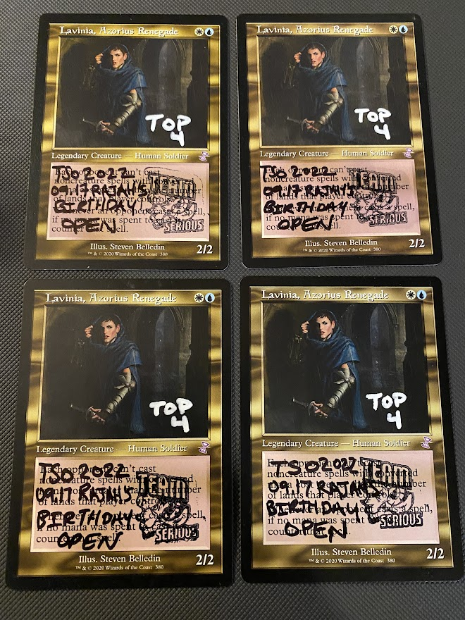
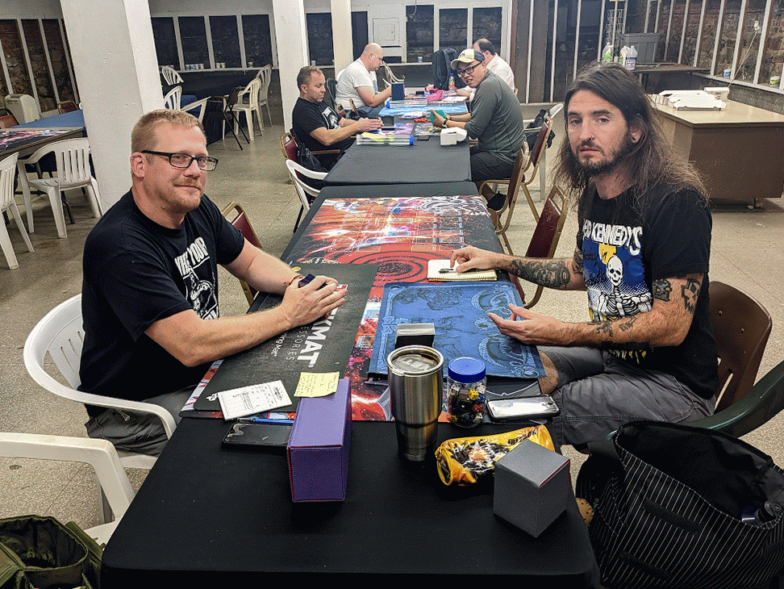
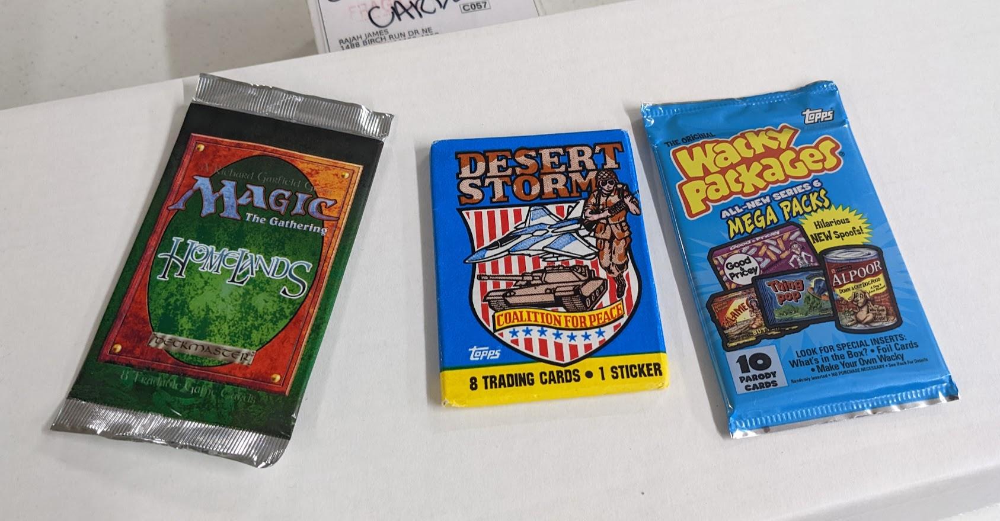
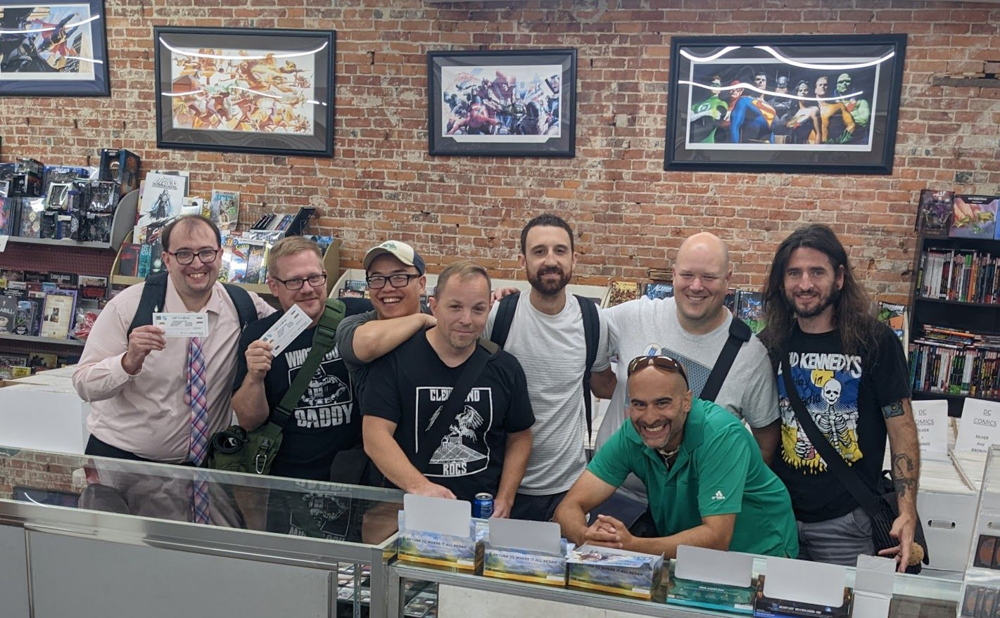

*Originally posted to The Mana Drain on 18 September 2022. The forum has since reorganised and the thread is gone; this is ported from the [archived copy](https://web.archive.org/web/20221207071535/http://www.themanadrain.com/topic/3862/2022-09-17-team-serious-open-all-american-cards-and-comics-warren-oh-results/1?lang=en-US).*

8 wizards gathered to battle for glory in  my 'birthday' Vintage! Paper Vintage is (hopefully) becoming more regular in NEO, with All-American Cards and Comics hosting us again, now for the second time. Big thanks to them as always!

Mocha House was our breakfast spot again! I had the Mocha House platter. Recommend.

Make sure to catch us for the next Team Serious Open event, TBA! Tentative date is 2022.11.12.

## Standings

We played Swiss +1 rounds with no cut, with payout to T3. Here are the standings and archetypes.

[MTGMELEE](https://mtgmelee.com/Tournament/View/11179#standings)

| Rank | Points | Name             | Deck                |
|------|--------|------------------|---------------------|
| 1    | 9      | Rajah James      | Oops, All Spells!   |
| 2    | 9      | Anthony Michaels | RUG Delver          |
| 3    | 9      | Charles Rolko    | Aggro Shops         |
| 4    | 6      | Jonathan Brne    | Oops, All Spells!   |
| 5    | 6      | Justin Dewey     | 2CM / BCV           |
| 6    | 6      | Steven Sasala    | Aggro Shops         |
| 7    | 3      | Kyle Wells       | Hullbreacher Tinker |
| 8    | 0      | Jerry Yang       | GW Hatebears        |

## Meta

Workshops - 3 (Aggro, Combo)

Blue Combo - 3 (2x Oops, 1x Tinker)

Blue Aggro Control - 1 (RUG Delver)

Non-Blue Aggro - 1 (GW Hatebears)

## Decklists

















## Media

Top 4 Cards

Sup

Birthday Presents from "The" Kyle Wells! What a sweetheart. Thanks Kyle!

Top 8

