For the 5th consecutive year, the Middle School Intercontinental Championships were held at the Team Serious Invitational (6/12/26), located in a quaint and perfect location in Northeast Ohio. The TSI has become the event I look forward to each summer, and is heavy on pretty much everything that makes Magic great. TSI is a dual event featuring some of the strongest veteran MtG players around, with the Middle School event day 1, and featuring Vintage day 2. I’m going to focus on the MS format and day 1 of this event, as it is a format that has fast become a favorite of mine over the years due to nuance and nostalgia (not knocking premodern), and I think everyone should give it whirl – check it out if unfamiliar! (gold+proxy friendly too!)

The TLDR of it is this event rocks every year. Great company, food, plenty of drinks, camping, and real competitive focused MtG. (Also, the only MtG event I’ve taken a paddleboard to, and used!) Thanks to Rajah and his circle for being outstanding humans and hosts.

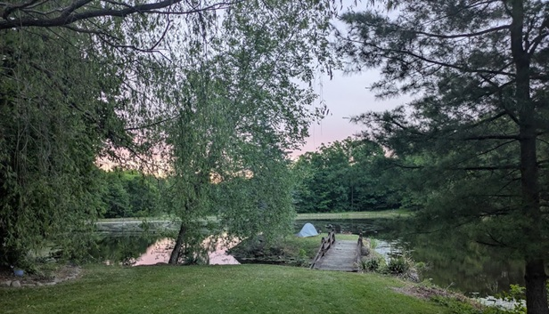{: width="50%"}

I’ll cut to the chase, as I could go on forever. Serious Magic = serious results.

I played forensic investigator on some lists (and a few are missing) – feel free to reach out with any updates or edits! Visual includes submitted deck photos, in no particular order (meant to be searchable).

## Final Standings for MS Intercontinental Championship @TSI7

| # | Player | Deck | Match | Games | Pts |
|---|--------|------|-------|-------|-----|
| 1 | Jason Hallman | Terrageddon | 6-0-0 | 12-3-0 | 18 |
| 2 | Max Gibson | - | 5-1-0 | 10-2-0 | 15 |
| 3 | Steven McGrew | Shadow-Geddon | 5-1-0 | 11-4-0 | 15 |
| 4 | Andy Probasco | Sligh | 4-2-0 | 9-7-0 | 12 |
| 5 | BCDRUID (Angelo) | Mono U Fliers | 4-2-0 | 10-7-0 | 12 |
| 6 | Tom Basketball | RG Survival | 4-2-0 | 9-6-1 | 12 |
| 7 | Yatskiva | Goblins | 4-2-0 | 8-6-0 | 12 |
| 8 | Stuart Ziarnik | Naya Zoo | 4-2-0 | 9-6-0 | 12 |
| 9 | Jimmy McCarthy | Reanimator-nought | 4-2-0 | 10-5-0 | 12 |
| 10 | Rajah James | RG Ponza? | 4-2-0 | 10-6-0 | 12 |
| 11 | Transcendence | Tide nought | 3-3-0 | 6-6-0 | 9 |
| 12 | ocksRock (Caffrey) | Ponza | 3-3-0 | 7-7-0 | 9 |
| 13 | Coffee_Cup | - | 3-3-0 | 9-8-0 | 9 |
| 14 | tmagrinijr | Zombie Infestation | 3-3-0 | 7-6-0 | 9 |
| 15 | Robert Foflygen | The Rock | 3-3-0 | 6-7-0 | 9 |
| 16 | Josh Burgoa | - | 3-3-0 | 8-6-0 | 9 |
| 17 | Paul Blakeley | Black MUD | 2-3-0 | 5-7-0 | 6 |
| 18 | Mike Klements | Elves | 2-4-0 | 5-9-0 | 6 |
| 19 | Mitchell Harmon | Miracle Gro | 2-4-0 | 4-8-0 | 6 |
| 20 | Alan Finney | Hermit druid | 2-4-0 | 5-9-0 | 6 |
| 21 | Patrick Vincent | - | 2-3-0 | 5-7-0 | 6 |
| 22 | Chad Proctor-Frazier | UG Madness | 2-2-0 | 5-4-0 | 6 |
| 23 | Kyle Wells | UR Prison | 1-4-0 | 3-8-0 | 3 |
| 24 | Michael O'Malley | - | 1-3-0 | 4-7-0 | 3 |
| 25 | NatM | - | 1-4-0 | 3-7-0 | 3 |
| 26 | sillysam71 | Turbolands | 0-3-0 | 1-5-1 | 0 |
| 27 | Jason Christopher | Quiet Speculation | 0-3-0 | 0-6-0 | 0 |

Melee Results: [melee.gg/Tournament/View/435351](https://melee.gg/Tournament/View/435351)

## Some Serious Decklists

*In no particular order.*

##### *Jason Hallman – Terrageddon – 1st place*

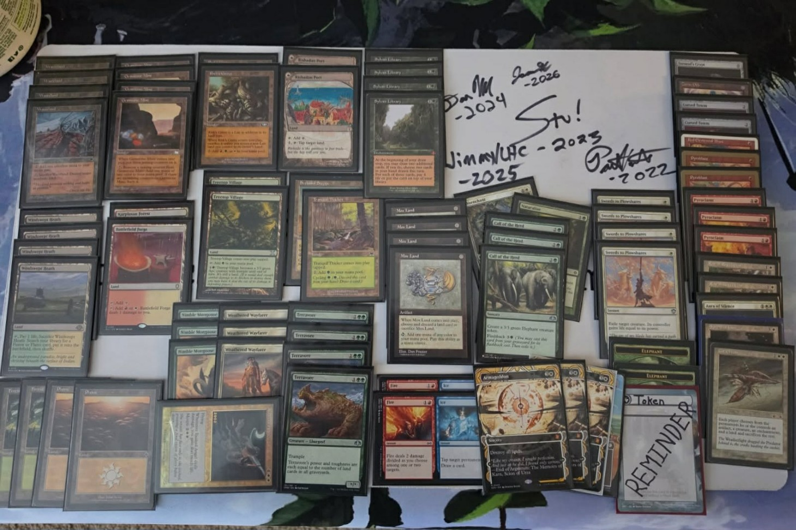{: width="35%"}

##### *Alan Finney – Hermit Druid Goblins (and winner of best deck photo)*

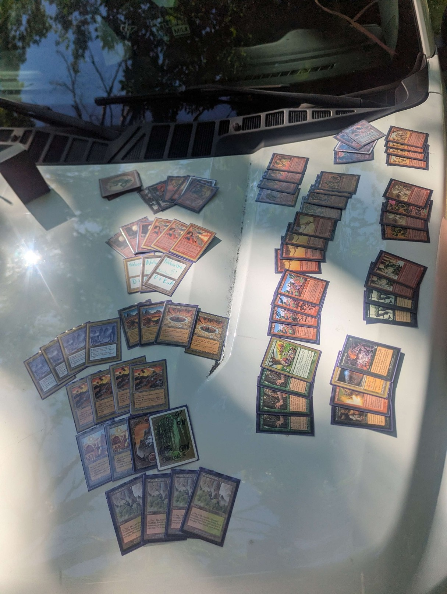{: width="35%"}

##### *Robert Foflygen – The Rock*

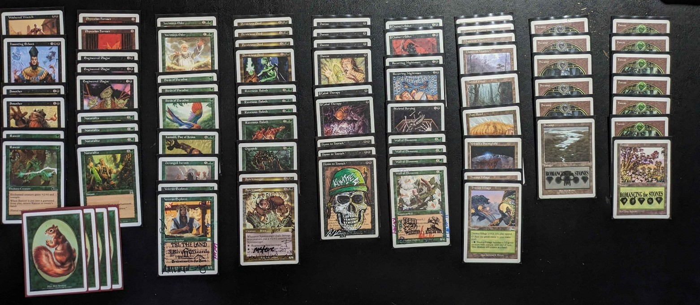{: width="35%"}

##### *Kyle Wells – UR Prison*

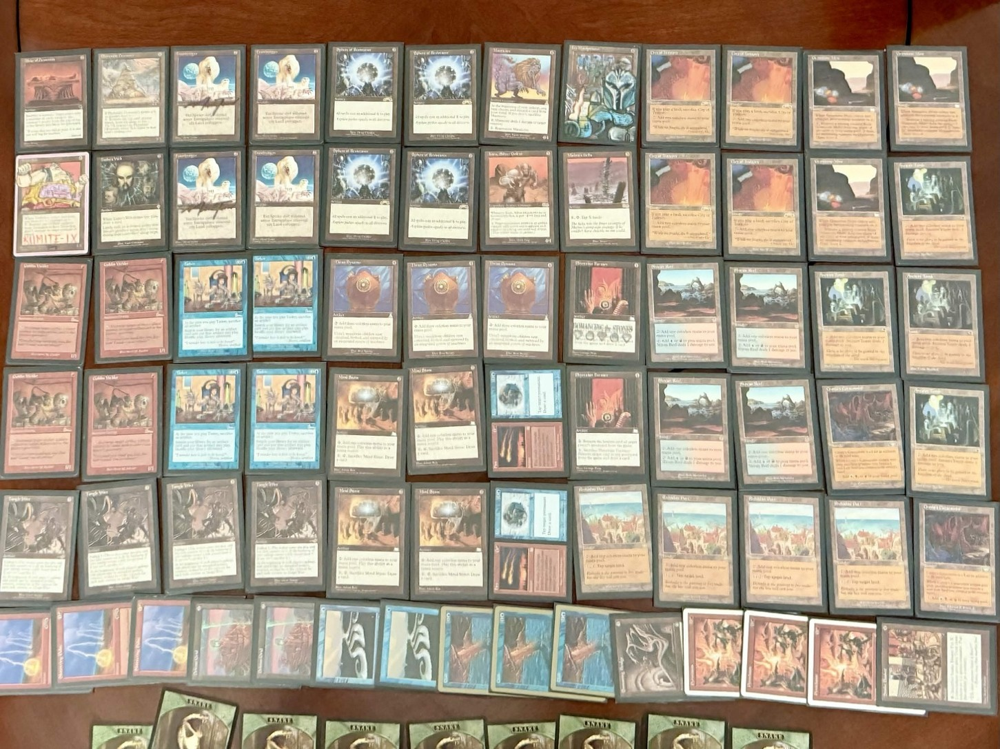{: width="35%"}

##### *Mike Klements – Elves*

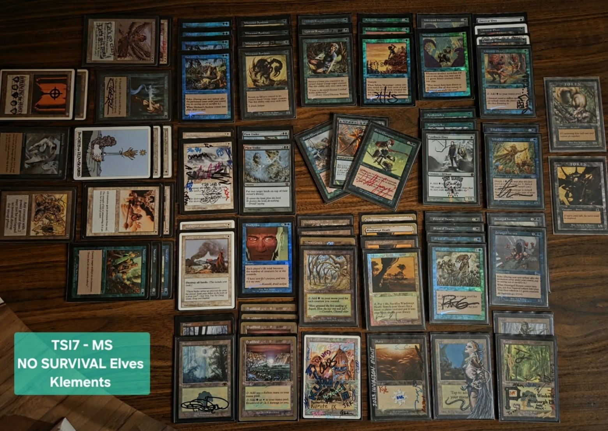{: width="35%"}

##### *Jimmy McCarthy – Reanimator-nought*

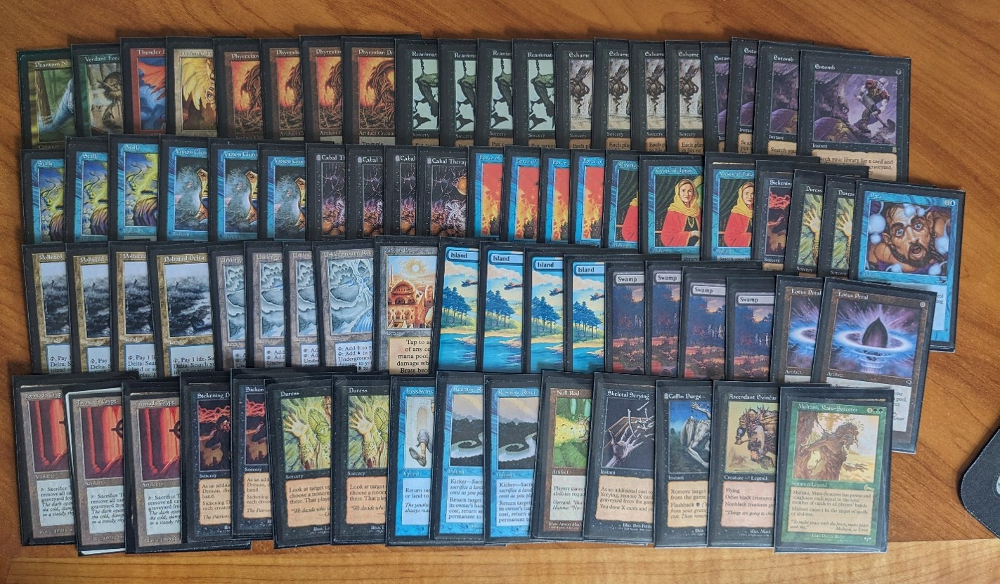{: width="35%"}

##### *Stuart Ziarnik – Naya Zoo*

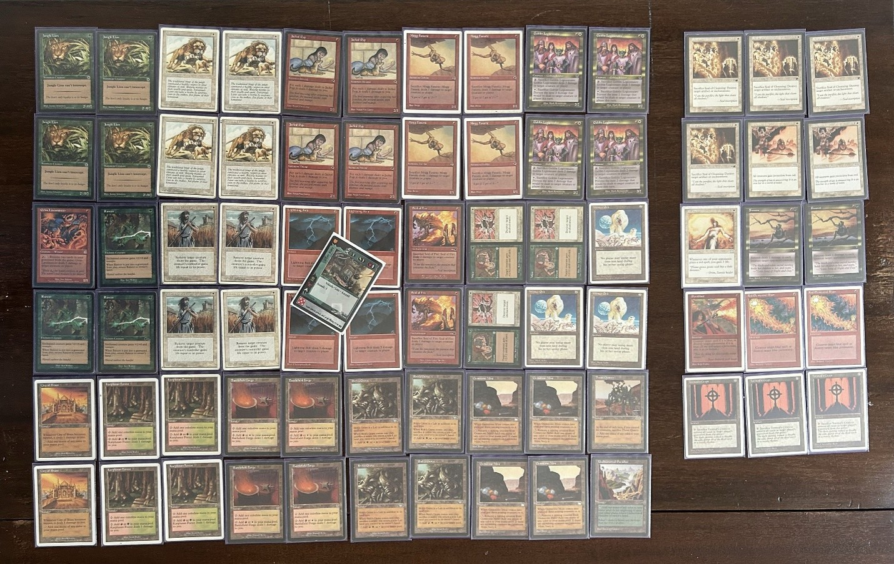{: width="35%"}

##### *Eric Caffrey*

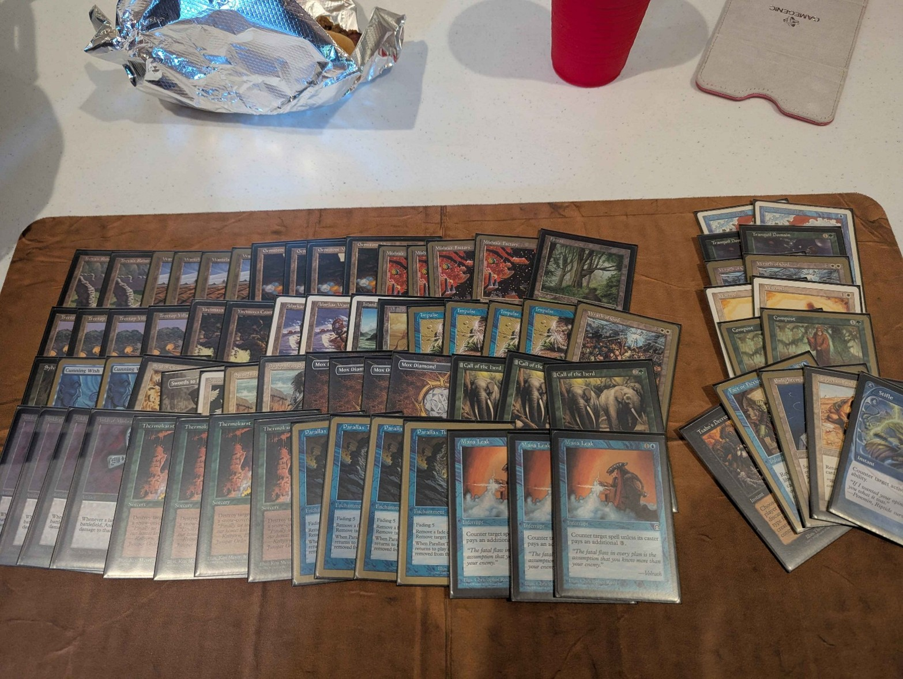{: width="35%"}

##### *Mitch Harmon – Miracle Gro*

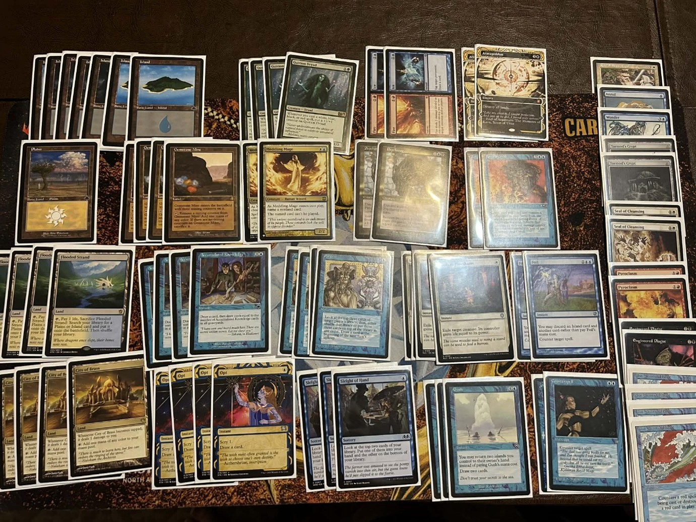{: width="35%"}

##### *Angelo – Mono U fliers*

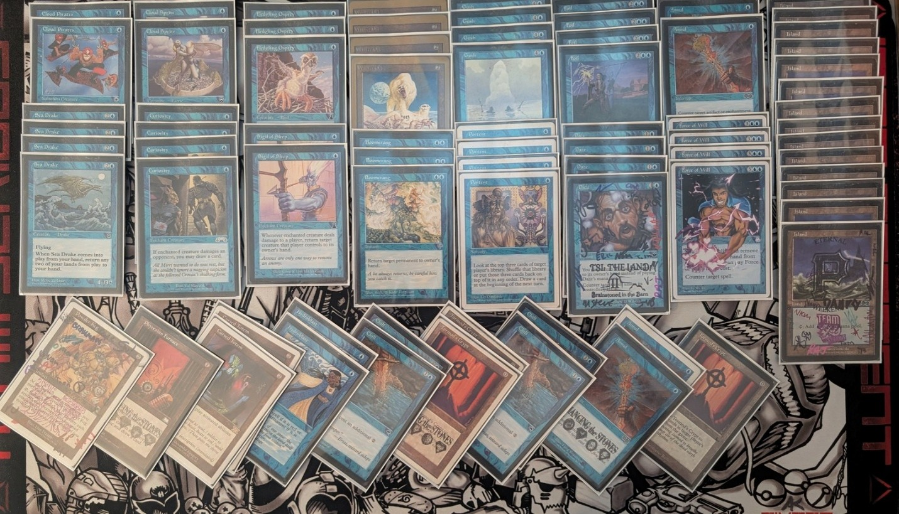{: width="35%"}

##### *Paul Blakeley – Black MUD*

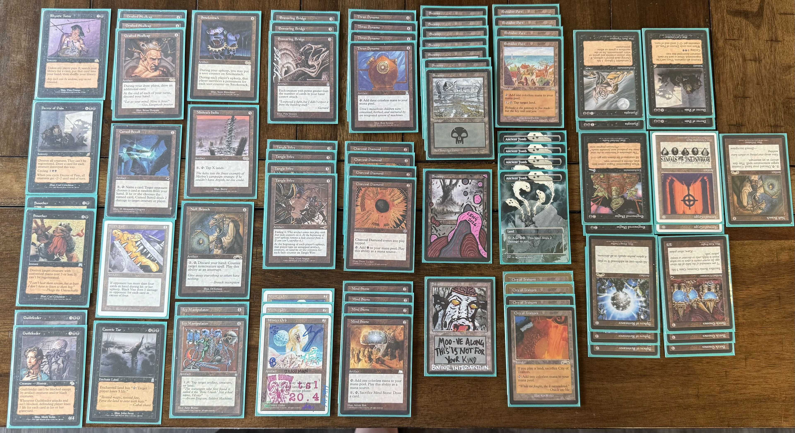{: width="35%"}

## Submitted Decklists

*Fifteen of the twenty-seven players submitted a list to [Melee](https://melee.gg/Tournament/View/435351). They are reproduced here as submitted — card names corrected to their official spellings so the card links work, nothing else changed. Listed by finish.*































## Recap

Jason Hallman was able to leave the Land with the Intercontinental MS Championship Mat with a perfect 6-0-0 Run on “Terrageddon”. He and I have jammed many casual games, and he has participated with the Romancing the Stones MS online leagues here and there, but this was his first IRL MS invitational!! Not only did Jason take down the tournament, but he Eric Caffrey and I were on the winning Castmaster (III) Team! I’m here to go on about MS, but a note: this was one of the most fun side events I’ve ever participated in! I highly recommend reading this great writeup on the Team Serious blog by Nat Moes: [Castmaster Season 3](https://teamserio.us/posts/20260613_castmaster-season-3)

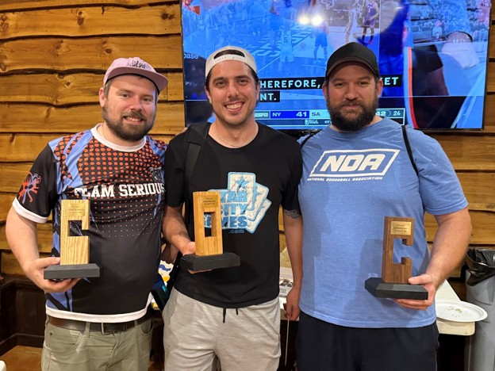{: width="50%"}

Again, this was a great event – I usually play some sort of low-to-the-ground combat trick heavy deck, and went with my go-to Elves pile for this (partly due to the time crunch and impending brain cells needed for pretending to be good at vintage the next day). It was an enjoyable tournament for me, but no one wants to hear another tournament report on this pile, piloted with the MtG equivalent of the MLB 9/9/9 challenge (probably doubled up on beer), SO I’ll let Jason finish this one out:

## Jason Hallman’s MS Tournament Report on Terrageddon

**Match 1 – Stiflenaught.** This match was fairly quick as the deck of my opponent decide it did not want to cooperate with him game 1 and game 2 my sideboard came in clutch with the REB and timely Disenchant to stall and catch the first resolved Dreadnaught after it got 1 swing in.

*Sideboard take:* I cut the 4x Armageddons as this matchup is too low on the mana cost. From the sideboard I pulled in 2 Pyroblasts, Aura of Silence & REB.

**Match 2 – Max Gibson.** This matchup was a bit of a blur, but think it was a creature heavy match. Game one I remember slamming Terravore turn 2 and turn 3 off a Diamond and the match ending shortly after that. For game 2, it was a Call of the Herd game just making 5x tokens and turning them sideways.

*Sideboard take:* This was another game I was sidelining the Armageddon package. I think that 3x Pyroclasms and Cataclysm came in to keep the board swept, but did not see them.

**Match 3 – Sligh (Yang style).** This match was the closest of day. Game 1 - started with a fast 20 Damage to my face of basically straight gas with an onslaught of burn spells with a jackal pup T1. Game 2 - was a longer game as burn spells were needed to stop the early Terravore. Game 3 - was an absolute nail biter. With early pressure coming in and a 10 shot to the dome on T3 (thwarted by swords-ing my own Elephant to stay at 3 life). A jackal pup swing brings me back down to 1 where I stayed the rest of the game. Terravore with some elephant blockers eventually ran the game down in 3 ish swings to steal it back.

*Sideboard take.* Another game of cut the 4x Armageddon, and a Weathered Wayfarer. Added in Zuran Orb, Sphere of Law and 3x Pyroclasms. While Pyroclasm isn't the best pick into this deck, it at least does something vs Armageddon being basically a dead draw against a deck that runs on a mountain and a bolt. Overall this matchup is just miserable for me.

**Match 4 – Shadow Geddon.** This was the hardest match of the day, hands down. Steven piloted this deck super well and it came down to a few lucky draws to get the win. Mongoose really shone in this matchup. Game 1 - I believe I just got smacked fairly easily with a Soltari Priest and some well timed Bolts and Swords removing any chance I had to get a stable foothold. An Armageddon after a timely Ice to tap down the Mountain to deny the double red to cast Dreams let me flail a bit longer but eventually fell to the priest I could not find removal for. Game 2 - The game without lands. This game was absolutely weird. We played at least 10 turns with only 3 lands between us. Mox Diamonds ran the table dropping little dudes and small stuff. A Ray of Revelation and a timely Disenchant kept the Scrollrack and Land Tax off the board while my opponent's Phyrexian Furnace nerfed my Vore until the Nimble Mongoose that refused to die won the day. Game 3 - This game was a complete scramble with leads changing with what felt every card being played (including lands) and had points where both of us had over 20 life. A nice Cataclysm reset and kept a good size Terravore which later got Swords-ed. After a Ray and its flashback clearing an Empyrial Armor and Scroll Rack, the Mongoose and an elephant eventually got through while exchanging blows with the priest.

*Sideboard take.* This was just rough and I had very little to do vs this deck. All my red cards were basically dead and Ice still did not feel great. I Cut 3x Armageddon, 2 Fire/Ice. Added Cataclysm, 2x Ray of Revelations, Aura of Silence & Zuran orb.

**Match 5 – Flying Blue.** Little flyers came down quickly and put a lot of pressure fast. Game 1 - A Terra Vore off some fast Diamonds and an elephant managed to steal the win with Ice holding off the Drake to buy a turn through my opponents Winter Orb. Game 2 - Went very quickly with flyers dropping fast. A 1 drop into a Drake with the Boomerang and counters keeping me a turn behind was too much to catch backup from. Game 3 - Was Mongooses leading the charge and a Rishadan Port locking down the mana base for a quickish win.

*Sideboard take.* With Angelo picking up its own land, time to side out Armageddon... again. 4x Armageddon out, 2 Pyroblast, REB and 1 Pyroclasm in.

**Match 6 – Goblins.** Not much to do but brace for the little red guys coming in hot. ( Editor’s note- ACKSHOEALLY, they’re green.)

Game 1 - The double Terravore by T4 put up a lot of pressure and eventually won the game quickly. Game 2 - The goblins ran into my Exalted Angel that I found for the first time all day after a Pyroclasm stalled the game out before a lethal Piledriver swing.

*Sideboard take.* 4x Armageddons out for the 6th time & 1 Weathered Wayfarer Out, 3 Pyroclasm, Cataclysm and Sphere of Law in. Some argument for the Zuran Orb or Cursed Totem, but I did not feel Prospector or Siege Gang's abilities were worth a slot to stop.

### Hindsight

The deck felt good for the day with the mixture of aggression on sizable creatures with a removal package behind it. To be honest the worst part of the deck was actually what it was named for. The Armageddon x4 felt so lack luster in these matchups and were only cast 3 or 4 times for the day, with 2 of them being countered vs the Stiflenaught deck. Could be the matchups I saw, but some consideration on the amount put into the deck will be needed. Played some very good players and had a blast, looking forward to next year.

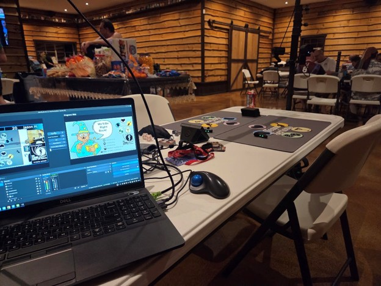{: width="50%"}

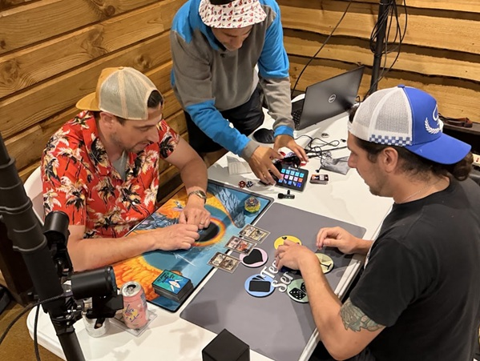{: width="50%"}

The last match features Angelo and I jamming “Forgotten Realms”, a constructed wedge format using only The Dark, Fallen Empires, and Homelands. I have to also plug it here. Super fun.

Until next time 🤙

-Mike
